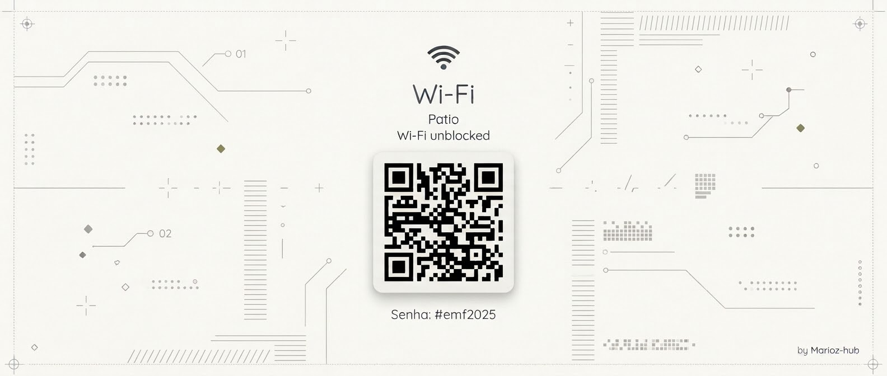

<!-- Banner Animado Digitando -->

  
  
  

<table>
  <tr>
    <td valign="middle">
      <h4><em>Bem-vindo! Sinta-se à vontade ;)</em></h4>
      <big><strong>Contribuidor:</strong> 🥇 Jhony</big>
    </td>
    <td valign="middle">
      
    </td>
  </tr>
</table>

---

## 📋 Update Logs (Clique para abrir)

  
<b>📂 Ver Histórico de Atualizações (v1.49)</b>

   
  <ul>
    <li>📶 <b>Wi-Fi Unblocked</b> adicionado como novidade.</li>
    <li>🎮 Aba de <b>Jogos</b> criada com CloudMoon e Calculadora Secreta.</li>
    <li>✨ CloudMoon e CrazyGames (Jumping) em destaque.</li>
    <li>✨ Calculadora Secreta, Doritus e Salva Estudante adicionados.</li>
    <li>📻 Novas salas no Radinho e ajustes no hub.</li>
  </ul>

---

## 🔥 Novidades

* 📶 **Wi-Fi Unblocked** — conexão de Wi-Fi comum e totalmente desbloqueada
* 🎮 **Aba de Jogos** — organização dedicada aos jogos de navegador, CloudMoon e Calculadora Secreta
* 🧮 **Calculadora Secreta** *(Digite `0000`)* — jogos ocultos na aba de Jogos
* ☁️ **CloudMoon** — cloud gaming na aba de Jogos
* 🆕 **Versão v1.49** — ajustes no hub, VPN separada e histórico atualizado

---

## 📶 Wi-Fi Unblocked

  
<b>🔓 Ver acesso</b>

   
  
Esta opção refere-se a uma conexão de Wi-Fi comum, operando de forma totalmente desbloqueada. Diferentemente da rede Wi-Fi padrão da escola, que é sujeita a bloqueios e restrições de acesso, esta alternativa não apresenta limitações impostas pela rede institucional, permitindo navegação irrestrita.

   
  

---

## 🎮 Jogos

| Ícone | Jogo / Portal | Tipo | Acesso |
| :---: | :--- | :--- | :--- |
| ☁️ | **CloudMoon** | Cloud Gaming | [Acessar Link](https://web.cloudmoonapp.com/pt/) |
| 🧮 | **Calculadora Secreta** *(Digite `0000`)* | Jogos Ocultos | [Acessar Link](https://calcsolver.net/) |
| 🌐 | **Navegador (DMC3)** | Browser / Jogos | [Acessar Link](https://tinyurl.com/dmc3-navegador) |
| 🎮 | **Site de Games (Wix3)** | Portal de Jogos | [Acessar Link](https://browser.wix3.com) |
| 🦘 | **CrazyGames (Jumping)** | Jogos de Navegador | [Acessar Link](https://www.crazygames.com/t/jumping) |

---

## 📻 Radinho

* **Acessar Rádio:** [Clique aqui para abrir](https://radinchat-hr4kkpzt.manus.space/)

| Canal | Sala |
| :---: | :--- |
| **CH 111** | 💻 Informática |
| **CH 19** | 💬 Chat Geral |

---

## ⌨️ Scripts (CMSP)

| Script | Status | Acesso |
| :---: | :---: | :--- |
| **Doritus** 🔥 | 🟢 Ativo | [Abrir Link](https://doritus.cloud) |
| **Zunder** | 🟢 Ativo | [Abrir Link](https://platformdestroyer.fun/tarefas) |
| **OpenFuture** | 🟢 Ativo | [Abrir Link](https://openfuture.lol/) |
| **Salva Estudante** | 🟢 Ativo | [Abrir Link](https://salvaestudante.com/tarefas) |

---

## 🌐 VPN (Unlock)

* **Extensão 1VPN:** [Google Chrome Web Store](https://chromewebstore.google.com/detail/vpn-grátis-free-vpn-1vpn/akcocjjpkmlniicdeemdceeajlmoabh)

> [!NOTE]
> No notebook, prefira o navegador **Firefox** na tela inicial.

---

## ⚒️ Tools & Utilidades

* **Jogos ☠︎:** [Abrir Apkworld](https://www.apkworld.de/)
* **Tools 🔨:** [Abrir Start.me](https://start.me/p/L1rEYQ/osint4all)

   
  <b>⚠️ Não é errado — é estratégia.</b>
    
  

  
ㅤ

   
  

    
     
    
  

   
  <blockquote>
    <b>📧 E-mail:</b> <code>oreintacaoff@gmail.com</code>
  </blockquote>
  

    🎮 Toque ou selecione o e-mail acima para copiar.
  

